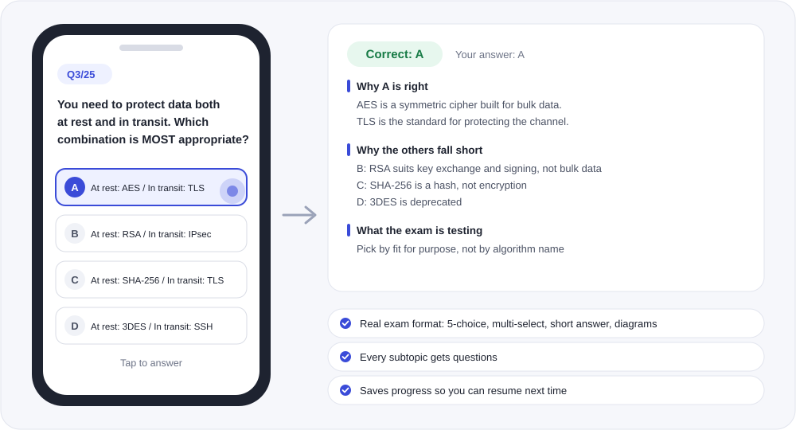
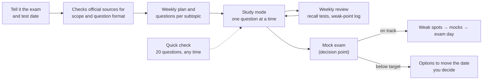
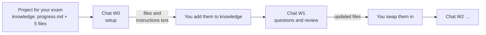

# Tap Exam Coach — a Claude skill for certification exams

[日本語](README.md) | English

[](https://docs.claude.com/en/docs/agents-and-tools/agent-skills/overview)
[](LICENSE)

**Just tell it the exam and your test date.** It looks up the official outline and the real exam's question format, builds a study plan, and drills you one question at a time in that same format. **Tap an answer** on your phone and the explanation comes right back. Works for any certification: CISSP, AWS, Japan's IPA exams and more.



## What it does



| Say this | What happens | Time |
|---|---|---|
| "I want to pass X. Make a plan." | Checks official sources, then builds a weekly plan, a to-do list and the first week's allocation | ~5 min |
| "Give me questions" / "Continue" | One question at a time in the real format, with an explanation after each answer. Picks up where you left off | 1–2 min per question |
| "Could I pass if I took it today?" | **Quick check**: 20 questions across all domains, scored at the end as on track / borderline / needs work | 15–30 min |
| "I want a mock exam" | Real question count, domain mix and time limit. Scores by domain and checks your pacing | Same as the real exam |

## How it differs from a question bank

- **Same format as the real exam.** Choice labels (A–D or ア–エ), 5-choice, "choose two", true/false combinations, short answers, and network diagrams or logs to read, all matched to what the real exam uses.
- **No hints.** Headings are just "Q3/25". Correct answers are spread evenly across positions, and the right option is never the only long or explained one.
- **Full coverage.** Each week starts by assigning questions to every subtopic, at least one each.
- **Useful explanations.** Why the answer is right, why each other option falls short, what the exam is really testing, and how to tell similar terms apart.
- **Follows up on mistakes.** Wrong answers are tagged (knowledge gap / misread / wrong perspective) and re-tested in the following week's recall test.
- **Resumes across conversations.** Progress is saved as Markdown in `exam-coach-data/<exam>/`.

## Supported question formats

| Format | How you answer |
|---|---|
| Single choice (up to 4 options) | Tap |
| Single choice (5+ options) | Type the number |
| Multiple response ("choose two") | Tap (multi-select) |
| True/false combinations | Tap |
| Short answer (term, number, length-limited) | Type it; graded point by point |
| With diagrams (network maps, logs, tables) | Read the figure, then answer in one of the formats above |

Long essays and hands-on labs are out of scope. If an exam has such sections, the skill says so when it builds your plan.

## Installation

**Claude Code (plugin)**: run this in a session (Claude Code 2.1.275 or later):

```
/plugin install tap-exam-coach-skill --marketplace jyu0414/tap-exam-coach-skill
```

**Claude Code (manual)**: put the `tap-exam-coach-skill/` folder in `~/.claude/skills/` (all projects) or in your project's `.claude/skills/`.

**Claude.ai**: download `tap-exam-coach-skill.skill` from [Releases](../../releases) and upload it under Skills in Settings.

The skill's instructions are written in Japanese, but it works in English too.

## Using it in a Claude.ai project, one chat per week

Create one project per exam, then start a new chat for each week, mock exam or quick check. Claude can't edit a project's knowledge, so at the end of each chat it hands you updated record files. Swap them into the project knowledge, then start the next chat.



1. Create a project on Claude.ai, with file creation (code execution) and this skill turned on
2. In the first chat, say "I want to pass X. Make a plan."
3. Add the six files it gives you to the project knowledge, and paste the text it gives you into the project instructions
4. Start a new chat and say "Start W1". At the end of each week, swap in the files it gives you and start the next week in a new chat

If you stop partway through a week, go back to the same chat and say "Continue".

## Layout

```
tap-exam-coach-skill/
├── SKILL.md                 When to use it, overall flow, rules applied every time
├── references/
│   ├── setup.md             Exam and format research, plan, allocation
│   ├── question-rules.md    Per-question flow, answer UI, question-writing rules, pre-check
│   ├── formats.md           Single/multi choice, combinations, short answer, diagrams, long scenarios
│   ├── quick-check.md       Quick check
│   ├── mock-mode.md         Mock exam
│   ├── review.md            Mistake types, weak-point log, recall tests, re-drills
│   ├── records.md           Record file formats
│   └── project-chats.md   One chat per week in a Claude.ai project
├── templates/               Templates for the record files
└── evals/                   Test cases (runnable with `claude plugin eval`)
```

## License

[MIT](LICENSE)
