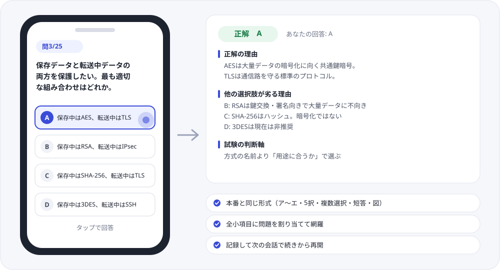
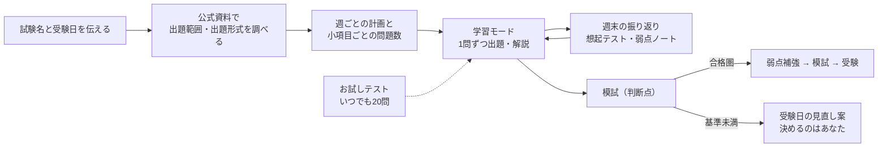

# Tap Exam Coach — 資格試験コーチ Claude スキル

日本語 | [English](README.en.md)

[](https://docs.claude.com/en/docs/agents-and-tools/agent-skills/overview)
[](LICENSE)

**試験名と受験日を伝えるだけ。** 公式の出題範囲と本番の出題形式を調べて計画を立て、本番と同じ形式の問題を1問ずつ出し、スマホで**タップして答える**と解説が返ってきます。CISSP、情報処理安全確保支援士、AWS認定など、どの資格試験でも使えます。



## 何ができるか



| こう話しかける | 何が起きるか | 時間の目安 |
|---|---|---|
| 「〇〇に合格したい。計画を立てて」 | 公式資料を調べ、週割の計画・TODO・第1週の割り当てを作る | 5分 |
| 「問題を出して」「続きから」 | 本番形式で1問ずつ出題。答えたらすぐ解説。記録から続きを再開 | 1問1〜2分 |
| 「今受けたら受かりそう？」 | **お試しテスト**。全分野から20問、最後にまとめて採点し「合格圏／ボーダー／要補強」を出す | 15〜30分 |
| 「模試をやりたい」 | 本番の問題数・配分・時間で出題。分野別の正答率と時間配分を評価 | 本番と同じ |

## ふつうの問題集との違い

- **本番と同じ形式で出る。** 選択肢の記号（A〜D、ア〜エ）、5択、「2つ選べ」、正誤の組合せ、短答（字句・〇字以内）、構成図やログの読み取りまで、調べた本番の形式に合わせます。
- **ヒントを出さない。** 見出しは「問3/25」の番号だけ。正解の位置はA〜Dに均等に散らし、正解だけ長い選択肢や理由つきの選択肢は作りません。
- **抜けなく出す。** 週の初めに小項目ごとの問題数を決め、全小項目に最低1問を割り当てます。
- **解説が実用的。** 正解の理由、他の選択肢が劣る理由、試験が求める判断軸、似た用語の区別まで出します。
- **弱点を追いかける。** 誤答は「知識不足／読み違い／試験の視点とずれた」に分けて記録し、翌週の想起テストで回復したかを確かめます。
- **会話が切れても続きから。** 進み具合は `exam-coach-data/<試験名>/` に Markdown で残ります。

## 対応している出題形式

| 形式 | 答え方 |
|---|---|
| 択一（4つ以下） | タップ |
| 択一（5つ以上） | 番号を入力 |
| 複数選択（「2つ選べ」） | タップ（複数） |
| 正誤の組合せ | タップ |
| 短答（字句・数値・〇字以内） | 入力。要素ごとに○△×で採点 |
| 図表つき（構成図・ログ・表など） | 図を見て上のどれかで回答 |

数百字の論述と実技は対象外です。対象外の科目がある試験では、計画を作るときにそう伝えます。

## インストール

**Claude Code（プラグイン）** — セッション内で次を実行します（Claude Code 2.1.275 以降）。

```
/plugin install tap-exam-coach-skill --marketplace jyu0414/tap-exam-coach-skill
```

**Claude Code（手動）** — `tap-exam-coach-skill/` フォルダを `~/.claude/skills/`（全プロジェクト）またはプロジェクトの `.claude/skills/` に置きます。

**Claude.ai** — [Releases](../../releases) から `tap-exam-coach-skill.skill` をダウンロードし、設定画面のスキルからアップロードします。

## 構成

```
tap-exam-coach-skill/
├── SKILL.md                 いつ使うか、全体の流れ、毎回守るルール
├── references/
│   ├── setup.md             試験情報・出題形式の調査、計画、割り当て
│   ├── question-rules.md    1問の流れ、回答UI、問題文のルール、出題前の点検
│   ├── formats.md           択一・複数選択・組合せ・短答・図表・大問の出し方
│   ├── quick-check.md       お試しテスト
│   ├── mock-mode.md         模試
│   ├── review.md            誤答の分類、弱点ノート、想起テスト、再出題
│   └── records.md           記録ファイルの書式
├── templates/               記録ファイルのひな形
└── evals/                   テストケース（`claude plugin eval` で実行できる）
```

## ライセンス

[MIT](LICENSE)
